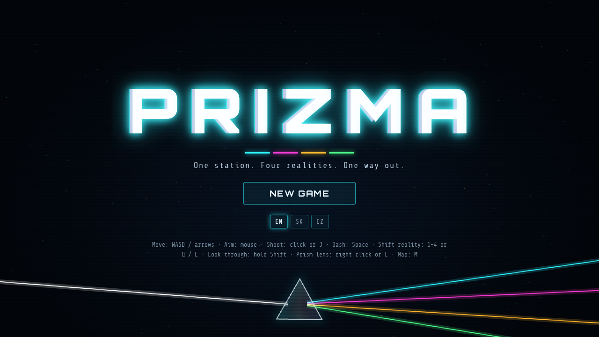
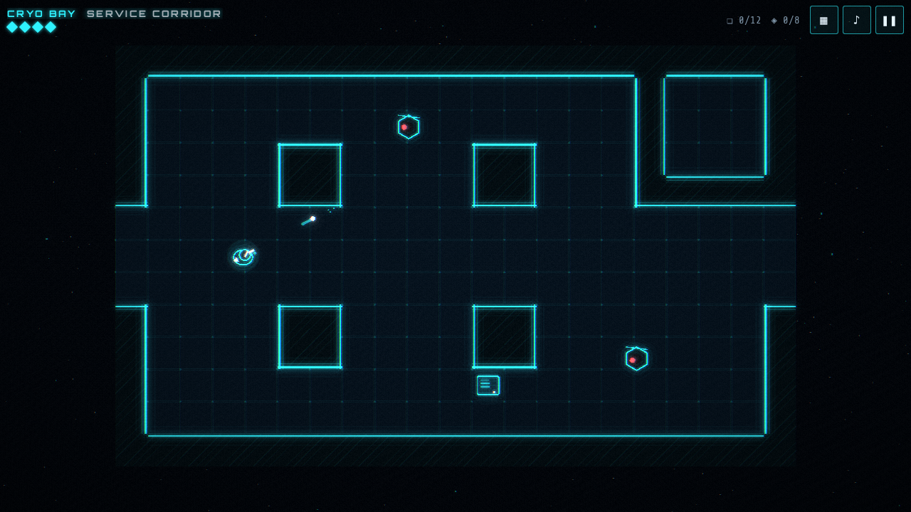
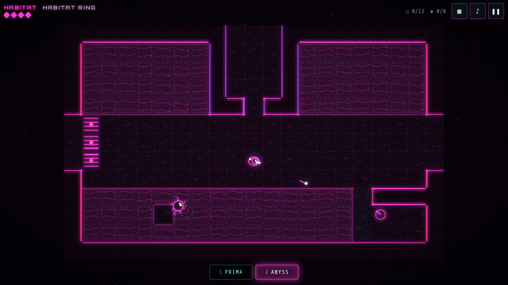
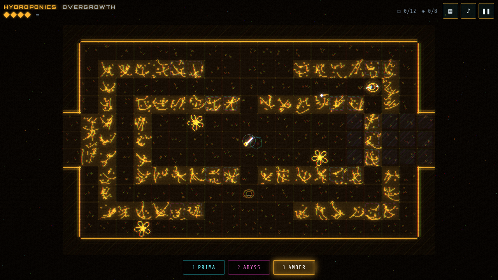
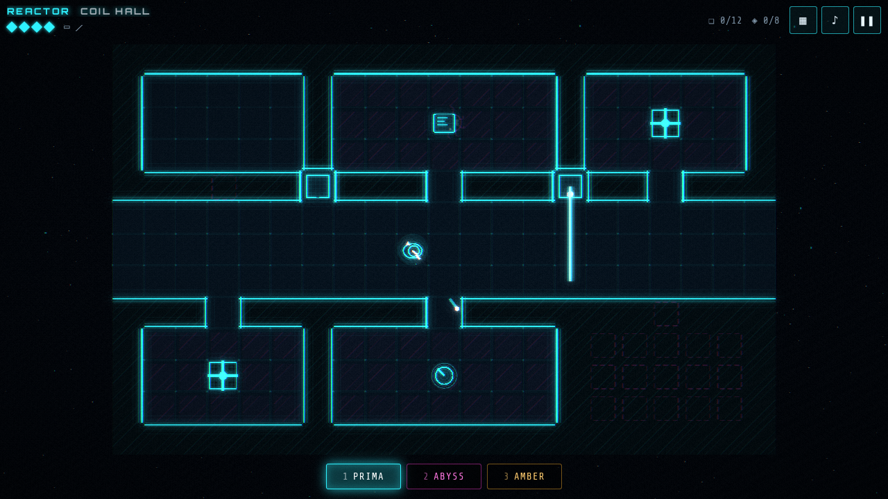
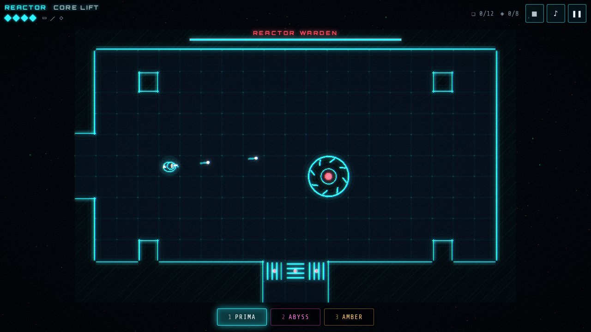
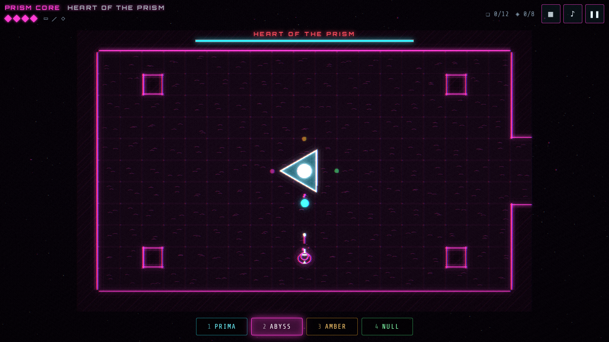
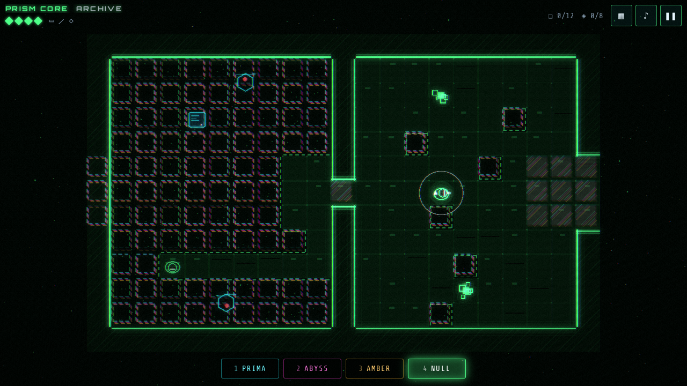
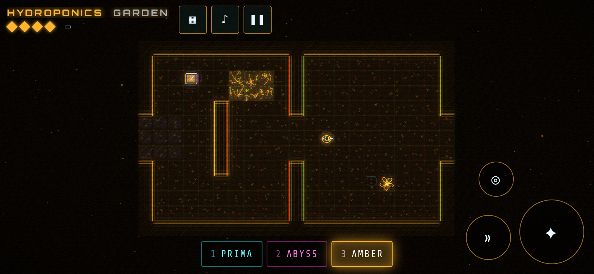

# Prizma

A neon sci-fi action mystery set in four mirrored realities. Research station Prizma tried to split reality like light through a prism, and it worked too well. You wake up as maintenance technician T-7, the security drones still think you are an intruder, and every room on the station now exists in four versions at once.

**▶ Play online: https://darangonaut.github.io/prizma/**



## Four realities, one position

You can step into another version of the room at any moment, and you stay in the same spot. You can only step where the other version has room for you: a wall, deep water or a beam there blocks the shift.

| Key | Reality   | What happened there                                        | Who lives there now                          |
| --- | --------- | ---------------------------------------------------------- | -------------------------------------------- |
| 1   | **Prima** | the original station, evacuated, still in lockdown         | security drones and turrets                  |
| 2   | **Abyss** | a coolant breach flooded every deck                        | the drowned, who swim and lunge              |
| 3   | **Amber** | time ran faster: centuries passed and the garden took over | spore pods                                   |
| 4   | **Null**  | the improbable reality, slowly being erased                | glitches that follow you from world to world |

**Shifting is your escape, your shortcut and your weapon:**

- **Escape.** Enemies and their bullets exist only in their own reality. Step into another one and a volley passes straight through you.
- **Shortcut.** A corridor that collapsed in Prima may be open in Abyss. A flooded hall in Abyss may be dry in Prima.
- **Weapon.** Step into a spot where something stands in the other reality, and it gets torn apart.

Hold **Shift** (or ◎ on a phone) to look through into the other realities: their walls, enemies and bullets glow where they differ from yours.

## The station

Twenty-four rooms in five zones: Cryo Bay, Habitat, Hydroponics, Reactor and the Prism Core. Along the way you find:

- **Reality shards** that tune you to Abyss, Amber and finally Null.
- **A keycard** in the flooded lockers, once you restart the pumps.
- **A plasma cutter** that lets your shots burn through Amber's vines.
- **A prism lens** whose charge passes through every reality at once.
- **Integrity cores** that add to your health.
- **Terminals** that save your progress. From any terminal you can travel to another one on the station map (M).

Two bosses guard the way: the **Reactor Warden**, who keeps jumping between realities, and the **Heart of the Prism**, which exists in every reality but can only be hurt in one of them at a time.

<table>
<tr>
<td><br><sub>Security drones in the service corridor</sub></td>
<td><br><sub>The flooded Abyss, with Prima's walls glowing through</sub></td>
</tr>
<tr>
<td><br><sub>Amber: centuries of overgrowth and spore pods</sub></td>
<td><br><sub>Coil lasers cut through every reality</sub></td>
</tr>
<tr>
<td><br><sub>The Reactor Warden</sub></td>
<td><br><sub>The Heart of the Prism fires each volley into one reality</sub></td>
</tr>
<tr>
<td colspan="2"><br><sub>Null, the reality that forgets itself, seen through Prima</sub></td>
</tr>
</table>

## Story

Director Vera Sund stayed behind in the core. Holographic logs and **echoes**, other versions of you left behind in the other realities, tell you why. There are 12 logs and 8 echoes. Three endings wait at the heart of the Prism, and the last one needs every echo.

## Controls

| Action                | Keyboard and mouse  | Gamepad     | Touch               |
| --------------------- | ------------------- | ----------- | ------------------- |
| Move                  | WASD / arrows       | left stick  | left thumb anywhere |
| Aim and shoot         | mouse + click, or J | right stick | ✦ (aims by itself)  |
| Dash (dodges bullets) | Space               | A           | »                   |
| Shift to a reality    | 1 2 3 4, Q / E      | LB / RB     | tap the reality     |
| Look through          | hold Shift          | Y           | hold ◎              |
| Prism lens            | right click or L    | B / LT      | ◇                   |
| Map, pause            | M, Esc              | Back, Start | ▦, ❚❚               |

English (default), Slovak and Czech. Progress is saved in the browser.

<p align="center"></p>

## Development

TypeScript, Vite and PixiJS 8. All graphics are vector shapes drawn in code, finished by a full-screen shader (`src/render/post.ts`) that adds the glow, the chromatic aberration, the scanlines and the glitch when you shift. Music and sounds are synthesized with the Web Audio API, with one ambient layer per reality that crossfades as you shift. There are no image or audio files.

```bash
npm install
npm run dev          # local server
npm test             # tests, including a search that proves the game can be finished
npm run deploy:pages # build and publish to GitHub Pages
```

- `src/game/` holds pure, deterministic game logic with no PixiJS or DOM: the simulation (`sim.ts`), the enemies and bosses (`enemies.ts`) and the station map (`rooms.ts`). Each room is an ASCII map with one layer per reality.
- `tests/explore.ts` explores the station breadth-first across rooms and realities, picking up items as it goes. The tests check that everything can be found, that the game can be finished, and that each gate holds: without the right shard, keycard, cutter, lens or a defeated warden you cannot get past it.
- `tests/sim.test.ts` covers movement, shifting, combat, devices, both boss fights and a 20-second run of every room's enemies.
- `src/render/` holds the renderer and the shader, `src/audio/` the synth, `src/input/` keyboard, mouse, touch and gamepad, and `src/ui/` the texts in three languages and the title animation.
