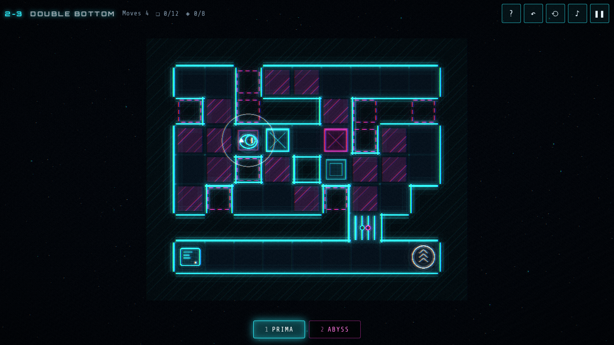
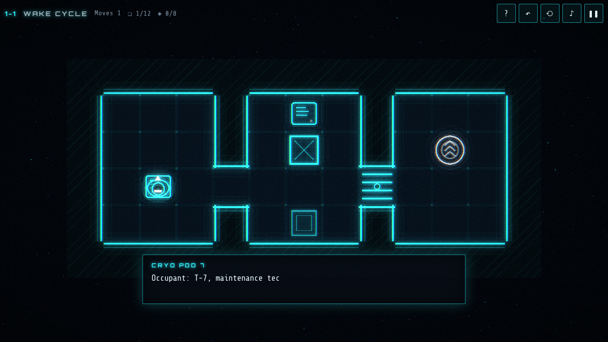

# Prizma

A neon sci-fi puzzle mystery set in four mirrored realities. Research station Prizma tried to split reality like light through a prism, and it worked too well. You wake up as maintenance technician T-7, and every room on the station now exists in four versions at once.

**▶ Play online: https://darangonaut.github.io/prizma/**


## Four realities, one position

You stand in the same spot in every reality. Shifting takes you to another version of the room. You can only shift if that version has room for you: a wall, deep water or a crate there blocks the shift. Neither version of a corridor may go all the way through, but stitched together they might.

| Key | Reality   | What happened there                                        |
| --- | --------- | ---------------------------------------------------------- |
| 1   | **Prima** | the original station, evacuated and silent                 |
| 2   | **Abyss** | a coolant breach flooded every deck                        |
| 3   | **Amber** | time ran faster: centuries passed and the garden took over |
| 4   | **Null**  | the improbable reality, slowly being erased                |

Hold **Space** (or ◎ on a phone) to look through into the other realities. Their walls glow faintly where they differ from yours: hatching marks an obstacle in the other world, a dashed frame marks a passage you could use there.

## Mechanics

- **Crates and pressure plates.** A plate holds a door open while something rests on it.
- **Shared wiring.** A plate in one reality can open a door in another.
- **Pumps, keycards and vines.** Drain the flooded reality, find the card in its lockers, cut through the overgrowth of Amber with a plasma cutter.
- **Entangled crates.** One crate that exists in every reality at once. It moves everywhere or nowhere, so it only moves if every world has room for it.
- **Beams and mirrors.** Reactor lasers block your path. Rotate mirrors to guide them to the receivers, and use phase windows that carry a beam into another reality.
- **Undo and restart.** Every move can be taken back (Z), and every chamber can be restarted (R).

<table>
<tr>
<td><br><sub>The flooded Abyss, with Prima's walls glowing through</sub></td>
<td><br><sub>Amber: vines and an entangled crate</sub></td>
</tr>
<tr>
<td><br><sub>Reactor beams, mirrors and a phase window</sub></td>
<td><br><sub>Null, the reality that forgets itself</sub></td>
</tr>
<tr>
<td><br><sub>Looking through into the other realities</sub></td>
<td><br><sub>Holographic logs tell what happened on the station</sub></td>
</tr>
</table>

## Story

Fifteen chambers in five zones (Cryo Bay, Habitat, Hydroponics, Reactor and the Prism Core) lead you to Director Vera Sund and the reason behind the experiment. Holographic logs and **echoes**, other versions of you left behind in the other realities, tell the rest. There are three endings, and the last one needs every echo.

## Controls

| Action                  | Keyboard            | Touch           |
| ----------------------- | ------------------- | --------------- |
| Move / push             | ← ↑ → ↓ / WASD      | pad or swipe    |
| Shift to a reality      | 1 2 3 4             | tap the reality |
| Previous / next reality | Q / E               |                 |
| Look through            | hold Space or Shift | hold ◎          |
| Undo / restart          | Z / R               | ↶ / ⟲           |
| Pause                   | Esc / P             | ❚❚              |

English (default), Slovak and Czech. Progress is saved in the browser. The game works in a phone browser too.

<p align="center"></p>

## Development

TypeScript, Vite and PixiJS 8. All graphics are vector shapes drawn in code, finished by a full-screen shader (`src/render/post.ts`) that adds the glow, the chromatic aberration, the scanlines and the glitch when you shift. Music and sounds are synthesized with the Web Audio API, with one ambient layer per reality that crossfades as you shift. There are no image or audio files.

```bash
npm install
npm run dev          # local server
npm test             # tests, including a solver that proves every chamber can be finished
npm run deploy:pages # build and publish to GitHub Pages
```

- `src/game/` holds pure, deterministic game logic (no PixiJS or DOM). The chambers are ASCII maps with one layer per reality (`src/game/sectors.ts`).
- `tests/solver.ts` runs a breadth-first search over the full state of a chamber (position, reality, crates, mirrors, items) and finds the shortest solution. The tests also check that no chamber can be solved without the realities it is meant to need.
- The harder chambers come out of a **puzzle forge** (`tests/forge.test.ts`). It starts from a template with open cells and hill-climbs towards layouts whose shortest solution has the most pushes, mirror turns and shifts.
- `src/render/` holds the renderer and the shader, `src/audio/` the synth, and `src/ui/` the texts in three languages and the title animation.
